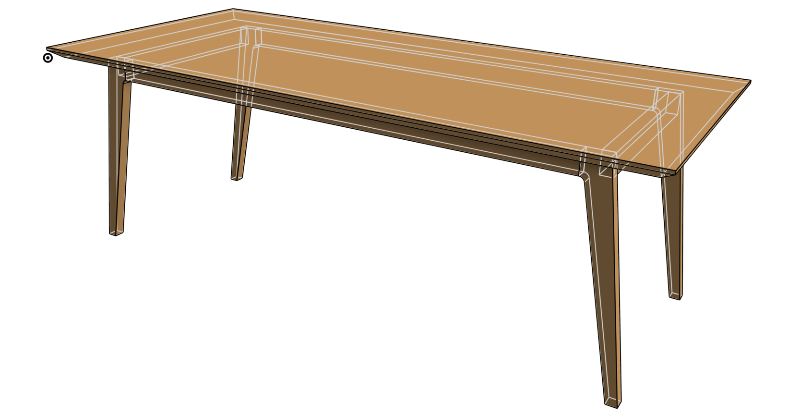

# Projects

## Home lab

Because I care about digital freedom and data sovereignty, I self-host my own services at home instead of relying on third-party clouds:

- **[Nextcloud](https://nextcloud.com/)**: personal cloud storage for files, photos, calendars and contacts.
- **[Passbolt](https://www.passbolt.com/)**: password manager. See my installation guide below.
- **[BookStack](https://www.bookstackapp.com/)**: wiki for documentation.
- **LDAP server**: centralised user accounts and authentication for the home services.
- **VPN**: secure remote access to the home network.

## [Passbolt on Ubuntu 24.04](./passbolt_Ubuntu24.04_Apache)
<!---
[//]: <> ## [Table](./table)

[//]: <> 

[//]: <> ## [Nightbox](./nightbox)

[//]: <> 
-->